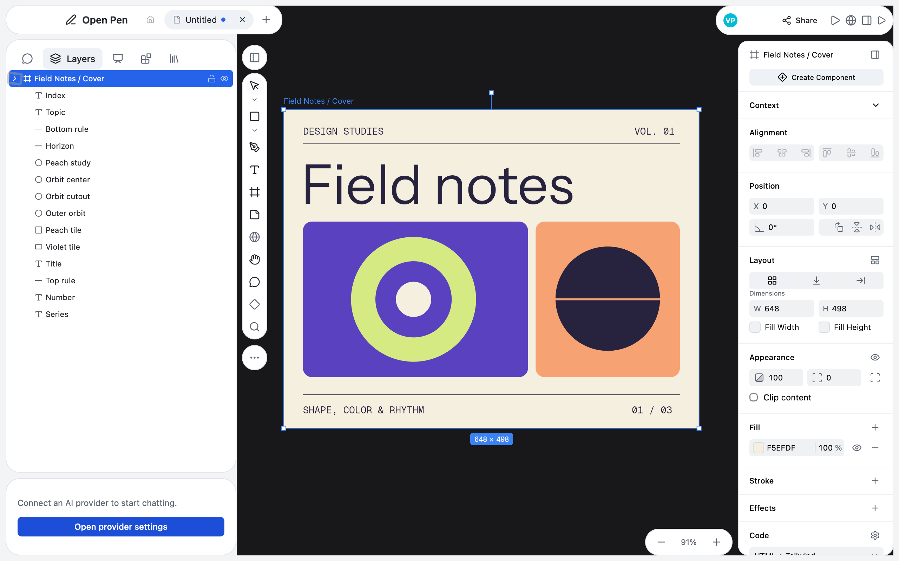

# Brutal

Brutal is a local-first desktop design editor built on the MIT-licensed OpenPencil engine. Signed beta builds are available for Apple silicon Macs. Full functional parity with Pen without an editor subscription or license activation remains on the roadmap. [OpenPencil engine](https://github.com/open-pencil/open-pencil)

[Brutal website](https://brutal.sh/) · [Install or update](https://brutal.sh/help/getting-started/) · [Help docs](https://brutal.sh/help/#docs) · [Privacy and usage stats](https://brutal.sh/help/privacy/#usage-stats)



Brutal is the new name for Open Pen. Existing design files and local installations use the same compatibility identifiers.

The implementation baseline is OpenPencil `24461adec7073312d460d76f08f069de18e4fb78`. Its attribution and MIT license remain intact. Pen's proprietary code and assets are not part of this repository.

The Script Gallery bundles eleven MIT examples from [High Agency's public pencil-scripts repository](https://github.com/highagency/pencil-scripts), with its [license notice](public/licenses/pencil-scripts.txt). Gallery previews are rendered by Brutal; bundled example fonts retain their OFL notices.

Export Snapshot packages available Script sources beside the design using relative JavaScript paths, including gallery examples. Keep the ZIP's extracted files together when opening the design in Pen. Missing sources refuse export; ordinary saves retain their authored source references.

## Run this fork

Use Bun 1.4.2 or newer. Install Git LFS and retrieve fixtures before running fixture-dependent tests.

```sh
bun install --frozen-lockfile
cp .env.example .env.local
bun run build:packages
```

Launch the desktop app with `bun run tauri dev`. This requires Tauri 2’s Rust and platform development tools. Use `bun run dev` for browser development and `bun run storybook` for component checks. Both are contributor tools.

Brutal has its own bundle identity, credential service, deep links and local MCP endpoint. The signed Apple-silicon beta uses the [Brutal update feed](https://brutal.sh/download/mac-updater.json). See [desktop configuration](docs/DESKTOP.md).

Cloud and usage sharing are off in the supplied development environment. Core editing requires no account. Optional external AI and image providers use their own authentication and billing.

Follow [the full feature catalog](docs/pen-feature-reference/README.md), [the parity matrix](docs/PARITY.md), [execution evidence](docs/ACCEPTANCE.md), and [the private tracking board](https://trello.com/b/Z2u82Q4O/open-pen-independent-design-editor). New local documents save as **Brutal documents (`.brut`)**. They use the same encoding as `.pen`. Supported `.pen` and `.fig` files can still be opened, edited and saved under their original extensions. Remote storage uses `.fig`. Unsupported content is reported before writing. See [format limits](packages/pen/README.md).

On desktop, **File → Open** imports supported FigJam layers from a local `.jam` archive. Save an imported board to a separate `.fig` design copy.

**File → Open** also imports modern `.sketch` archives as editable copies. The first importer covers pages, artboards, groups, rectangles, ovals, basic text, solid fills and borders, and common embedded images. Some layers and styles are omitted. Review the import notice and save edits to a separate `.fig` design copy.

**File → Open** imports supported vectors and text from `.svg` and compressed `.svgz` files as editable layers. SVG raster images and some SVG effects may be omitted. The source stays intact when you save a separate `.fig` copy. SVG documents must be 4 MB or smaller before and after decompression.

On macOS, **File → Open** places each page of a PDF or a PDF-compatible Illustrator (`.ai`) file as an image on its own canvas page. Save the artwork in a separate `.fig` copy. PDF text and Illustrator vectors are flattened. This importer accepts up to 32 pages and 32 MB, with bitmap size limits for larger pages or documents.

On macOS, **File → Open** imports supported 8-bit RGB Photoshop `.psd` and `.psb` files as editable image layers. It preserves groups, order, positions, visibility, and opacity. Files with features such as Photoshop text, masks, smart objects, artboards, or unsupported embedded color profiles open using the saved composite. Save a separate `.fig` copy to keep edits. The input limit is 32 MB, and individual layers can be up to 4096 pixels per side within the 24-megapixel total layer budget. The composite preview is up to 2048 pixels per side.

The [PRD](docs/PRD.md) defines the product and acceptance gates. The [task index](docs/TASKS.md) links the complete execution backlog; the [modularity audit](docs/MODULARITY.md) records the oversized-module review queue. See [tracking rules](docs/TRACKING.md) for the current work limit.

Start with the [prompt gallery](docs/PROMPTS.md), [Cursor/VS Code setup](docs/EDITOR-INTEGRATIONS.md), or [local Codex runtime guide](docs/LOCAL-RUNTIME.md). These guides state their verification limits; visual IDE extensions remain open.

## Brutal system requirements

The contributor browser build targets Chrome 111+, Edge 111+, Firefox 128+, Safari 16.4+ and iOS 16.4+.
Startup also checks WebAssembly, WebGL 2 and required JavaScript/CSS features; a browser
policy or disabled feature can prevent startup even when its version meets the baseline.
These are configured support thresholds, not evidence that every platform is qualified.

The desktop notice requires macOS 13+ with current Safari updates, Linux WebKitGTK 2.40+,
or a current Windows WebView2 runtime. Find signed Apple-silicon beta downloads in
[Brutal Releases](https://github.com/brutal-sh/brutal-feedback/releases). In the app, choose
**Help → Report an Issue** to open the public bug form. Review the diagnostic details you include.
Find guides and private security reporting in [Brutal Help](https://brutal.sh/help/#support).

## Privacy and usage stats

Beta 16 has usage sharing off. In beta builds that offer **Share stats**, sharing starts off and requires your consent. Change your choice in **Settings → Privacy**. The [public disclosure](https://brutal.sh/help/privacy/#what-is-sent) lists the fields and retention. Maintainers can find the receiver and build instructions on the [telemetry branch](https://github.com/jpoindexter/open-pen/tree/codex/brutal-telemetry).

## CLI

From this checkout, install dependencies and build the packages using the setup steps above. Run `bun open-pencil --help` to see the available commands.

The executable keeps the inherited `openpencil` name for compatibility. Use `bun open-pencil` to run this fork's version. See the [CLI reference](packages/cli/README.md) for commands and setup.

### Keep a headless document open

```sh
bun open-pencil interactive -i existing.pen -o edited.pen
```

Call tools from `tool list` one line at a time; `save()` writes the output and
`exit()` closes without another save. The [interactive guide](packages/docs/programmable/cli/app-control.md#headless-interactive-sessions)
describes arguments, retry and current tool-name limits.

Connect a persistent session to the running app with
`bun open-pencil interactive --app desktop --document-id <tab-id>`. It reports
and pins its document/page, supports `undo()`/`redo()`, and edits live; `exit()`
performs no additional save or discard. See the [connected session guide](packages/docs/programmable/cli/app-control.md#connected-interactive-sessions).

## Upstream acknowledgments

Thanks to [@sld0Ant](https://github.com/sld0Ant) (Anton Soldatov), who pushed for OpenPencil to be published, has backed and promoted it since, and built the first version of the [documentation site](https://openpencil.dev).

Thanks to everyone who has [contributed](https://github.com/open-pencil/open-pencil/graphs/contributors) code, translations, bug reports, and feedback.

Thanks to [Anthropic](https://www.anthropic.com) for supporting the project through its open source program, and to [CodeRabbit](https://www.coderabbit.ai) for reviewing every pull request for free.

## License

OpenPencil is licensed under the [MIT License](./LICENSE), except OpenPencil Cloud, which is licensed under the [Apache License 2.0](./LICENSES/Apache-2.0.txt). [`REUSE.toml`](./REUSE.toml) lists the exact paths.

Copyright (c) 2026 Danila Poyarkov and OpenPencil contributors.
